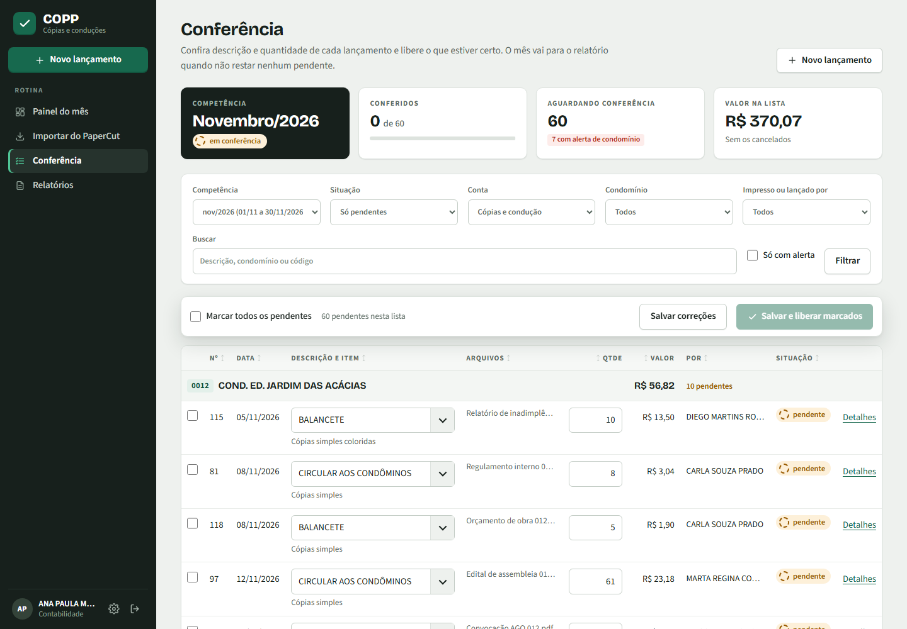

<p align="center">
  
</p>

<p align="center">
  <strong>Print and courier costs, reviewed before they reach the building's books.</strong><br>
  A web app that turns PaperCut print logs into per-building charges, with an accounting review step, a full audit trail and A4 reports ready for the building's financial statements.
</p>

<p align="center"><a href="README.md">Português</a></p>

---



> The interface and the business vocabulary are in Brazilian Portuguese, because that is what its users speak. This page summarizes the project in English.

## The problem

A Brazilian property management company prints thousands of pages a month on behalf of the residential buildings (*condomínios*) it manages: meeting minutes, balance sheets, notices, invoices. Each page has to be charged to the right building, with a description the building's manager understands, and the total goes into the monthly financial statement.

PaperCut knows how many pages were printed and on which shared account, but not whether the account was the right one, nor what the document was in plain words. Without a review step, a job charged to the wrong account ends up in the wrong building's statement, and nobody can tell who approved what.

**COPP is in production**, running on a Linux VPS behind Nginx. The company's monthly closing goes through it.

## What it does

- **Imports PaperCut CSV exports** (Brazilian Portuguese, European Portuguese or English column names), skips cancelled, refunded and unprinted jobs, and shows a **preview** before writing anything. Re-importing the same file, or partial files in any order, never duplicates a job.
- **Groups jobs into charges**: one per building × item (B&W, color, duplex) × description × who printed, within the accounting period. Prices come from the system's own price table, not from PaperCut.
- **Flags suspicious charges**: if the comment typed in PaperCut mentions another building's code, the charge arrives with a warning. Jobs charged to the wrong account can be **moved**, fully or partially.
- **Separates who records from who approves**: everyone can record manual copies, the dispatch team records courier trips, and **only Accounting reviews and approves**. Nobody approves their own entry.
- **Closes the month** with a configurable period (1st–30th or 16th–15th) and produces per-building A4 reports, matching the layout Accounting already used, plus a CSV export.
- **Keeps the history**: every edit, approval, cancellation, import and settings change is audited with author, time and before/after values.

## Run it in one minute

You only need **Node.js 22.13+**. No database server, no build step.

```bash
git clone https://github.com/IagoRPMan/copp.git
cd copp
npm install
npm run demo
```

Open <http://localhost:3210>. The demo builds a fresh database in `demo-data/` with **fictitious data** (12 buildings and a month of print jobs generated in PaperCut's format and imported through the production code path). Every password is `demo1234`:

| User | Role |
|---|---|
| `ana.contabil` | Accounting: reviews, edits inline, bulk-approves, moves jobs between buildings |
| `carla.gerente` | Building manager: records copies, cannot approve |
| `edson.exp` | Dispatch: the only role that records courier trips |
| `diretor` | Board: read-only dashboard and reports |
| `admin` | Administrator: settings, month closing, audit log |

## Engineering highlights

- **No database dependency**: SQLite ships with Node (`node:sqlite`), in WAL mode. One file is easier to run, back up (`VACUUM INTO`, online) and restore than a database server, at this scale.
- **Money as integer cents**, never floats. The price is frozen on each charge when it is created.
- **Idempotent import**: PaperCut exports have no job ID, so each job gets a key derived from its stable fields plus its order of appearance. The whole import, including new accounting periods, runs in a single transaction.
- **Server-rendered, no build**: Express + EJS and one progressive-enhancement script (currency mask, description picker, column sorting, bulk-approve confirmation).
- **Security**: scrypt password hashing, server-side sessions with `HttpOnly`/`SameSite` cookies, CSRF tokens on every POST, a CSP without `unsafe-inline`, login rate limiting, parameterized queries, CSV formula-injection protection, single-use password recovery codes stored only as hashes.
- **Permissions enforced on the server**, and tested end to end: the test suite boots the real app and tries to approve, cancel and record courier trips with the wrong role.
- **Operations built in**: `/saude` health endpoint, daily backups with retention, a hardened `systemd` unit, and a deploy script that installs next to the running version, runs the tests, switches over and **rolls back automatically** if the app does not come up.

See [docs/ARQUITETURA.md](docs/ARQUITETURA.md) for the flow diagram and data model (in Portuguese).

## Tests

```bash
npm test
```

Node's built-in test runner, no extra libraries. Each run uses a throwaway database; the business-rule tests start the server on a free port and talk to it over HTTP with sessions of different roles. CI runs them on Node 22 and 24.

## Author

Built by **Iago R. Prado Man** ([IRPM Tecnologia](https://github.com/IagoRPMan)), from requirements gathering with the accounting team to production deployment.

Released under the [MIT License](LICENSE).
