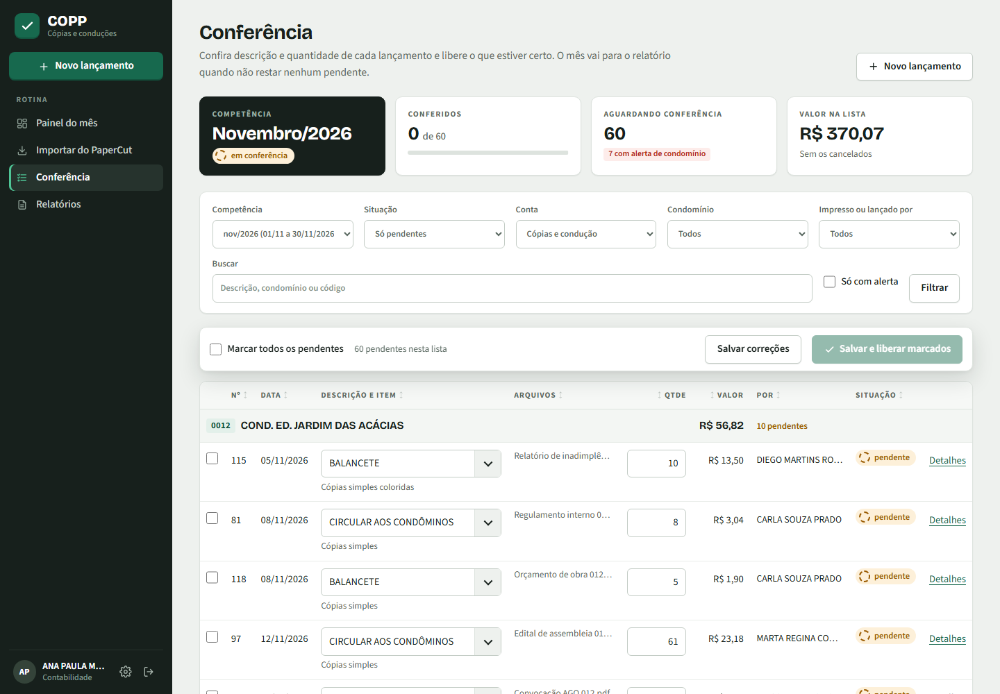
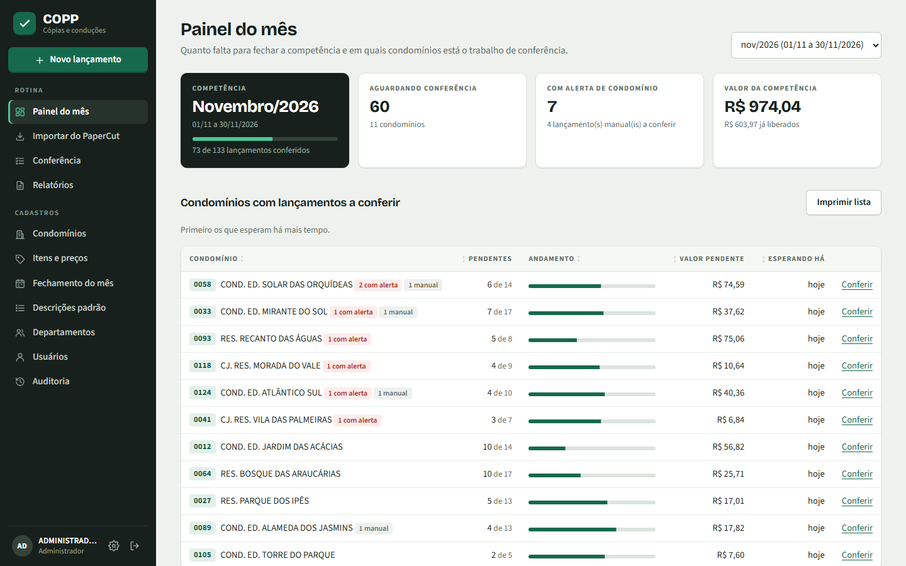
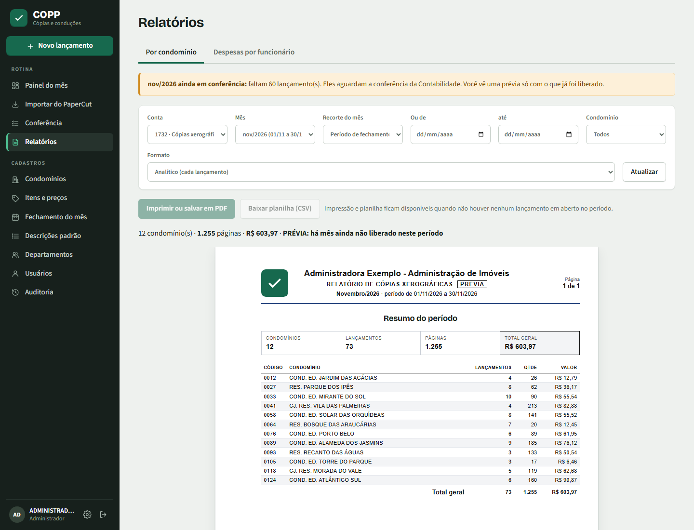
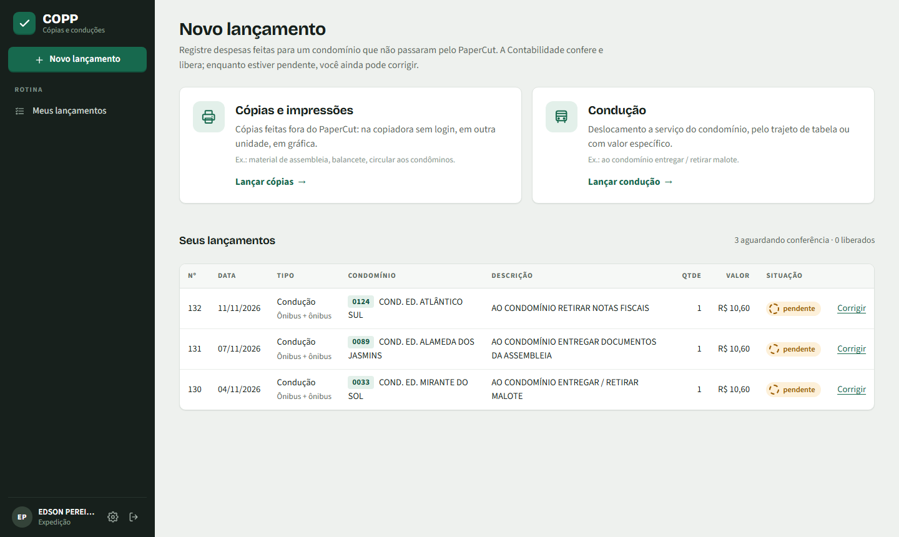

<p align="center">
  
</p>

<p align="center">
  <strong>Cópias e conduções, conferidas antes de chegar ao condomínio.</strong><br>
  Sistema web que transforma o log de impressão do PaperCut em lançamentos por condomínio, com conferência da Contabilidade, trilha de auditoria e relatório A4 pronto para a prestação de contas.
</p>

<p align="center">
  <a href="https://github.com/IagoRPMan/copp/actions/workflows/ci.yml"></a>
  
  
  <a href="LICENSE"></a>
</p>

<p align="center">
  <a href="#rodar-em-1-minuto">Rodar a demonstração</a> ·
  <a href="#decisões-técnicas">Decisões técnicas</a> ·
  <a href="docs/ARQUITETURA.md">Arquitetura</a> ·
  <a href="docs/OPERACAO.md">Manual de operação</a> ·
  <a href="README.en.md">English</a>
</p>

---



## O problema

Uma administradora de condomínios imprime, todo mês, milhares de páginas em nome dos prédios que administra: atas, balancetes, circulares, boletos. Cada página precisa ser cobrada do condomínio certo, com uma descrição que o síndico entenda, e o total entra na prestação de contas.

O PaperCut sabe quantas páginas saíram e de qual conta, mas não sabe se a conta estava certa, nem descreve o que foi impresso de um jeito que o síndico entenda. Sem conferência, um trabalho cobrado da conta errada vai parar na prestação de contas do condomínio errado, e não fica registrado quem aprovou o quê.

**O COPP está em produção** e roda numa VPS Linux atrás de Nginx. O mês da administradora fecha por ele.

## O que ele faz

| | |
|---|---|
| **Importa o PaperCut** | Lê o CSV exportado (em português do Brasil, de Portugal ou em inglês), ignora o que não foi impresso, cancelado ou reembolsado e mostra uma **prévia** antes de gravar. Reimportar o mesmo arquivo, ou arquivos parciais em qualquer ordem, não duplica nada. |
| **Agrupa em lançamentos** | Um lançamento por condomínio × item (P&B, colorida, frente e verso) × descrição × quem imprimiu, dentro da competência. O preço vem da tabela do sistema, não do PaperCut. |
| **Avisa o que parece errado** | Se o comentário digitado no PaperCut cita o código de outro condomínio, o lançamento chega marcado com alerta. Trabalhos cobrados da conta errada podem ser **movidos** para o condomínio certo, inclusive em parte. |
| **Separa quem lança de quem aprova** | Todos lançam cópias manuais; a Expedição lança condução. **Só a Contabilidade confere e libera**: ninguém aprova o próprio lançamento. |
| **Fecha o mês** | Com período configurável (1 a 30 ou 16 a 15). Quando não resta pendente, sai o relatório A4 por condomínio, no layout que a Contabilidade já usava, e a planilha CSV. |
| **Guarda a história** | Toda edição, liberação, cancelamento, importação e mudança de cadastro fica na auditoria, com autor, horário e o valor de antes e depois. |

<table>
  <tr>
    <td width="50%"><br><sub><b>Painel do mês:</b> quanto falta para fechar e em quais condomínios.</sub></td>
    <td width="50%"><br><sub><b>Relatório:</b> folhas A4 com margem de furação, prontas para imprimir ou salvar em PDF.</sub></td>
  </tr>
  <tr>
    <td width="50%"><br><sub><b>Novo lançamento:</b> cópias para todos, condução só para a Expedição.</sub></td>
    <td width="50%"><br><sub><b>Entrada:</b> o fluxo do sistema em três linhas.</sub></td>
  </tr>
</table>

## Rodar em 1 minuto

Precisa só do **Node.js 22.13 ou mais novo**. Não há banco para instalar nem etapa de build.

```bash
git clone https://github.com/IagoRPMan/copp.git
cd copp
npm install
npm run demo
```

Abra <http://localhost:3210>. A demonstração cria um banco novo em `demo-data/` com **dados fictícios** (12 condomínios, um mês de impressões geradas no formato do PaperCut e importadas pelo mesmo código de produção) e mostra os usuários no terminal. A senha de todos é `demo1234`:

| Usuário | Perfil | Experimente |
|---|---|---|
| `ana.contabil` | Contabilidade | Conferir, corrigir a descrição na própria lista, liberar em lote, mover um trabalho com alerta |
| `carla.gerente` | Gerência | Lançar cópias e ver que não há botão de liberar |
| `edson.exp` | Expedição | Lançar condução (só este perfil vê a opção) |
| `diretor` | Diretoria | Acompanhar o painel e os relatórios |
| `admin` | Administrador | Cadastros, fechamento do mês, auditoria |

Para rodar com um banco vazio, use `npm start`; na primeira vez o sistema cria o `admin` e grava a senha inicial em `data/admin-inicial.txt`.

## Decisões técnicas

**Sem dependência de banco.** O SQLite vem do próprio Node (`node:sqlite`), em modo WAL. Para o volume de uma administradora (milhares de lançamentos por mês), um arquivo único é mais simples de operar, copiar e restaurar do que um servidor de banco. O backup é um `VACUUM INTO` consistente, feito com o sistema no ar.

**Dinheiro em centavos inteiros.** Nenhum valor passa por ponto flutuante. O preço é gravado no lançamento no momento em que ele nasce: mudar a tabela não altera o que já foi cobrado, a menos que se peça para recalcular os pendentes.

**Importação idempotente.** O export do PaperCut não traz identificador de trabalho. Cada trabalho recebe uma chave derivada dos campos estáveis e da ordem de aparição; assim, duas reimpressões idênticas no mesmo segundo continuam sendo duas, e importar o mesmo arquivo de novo não duplica nada. A gravação inteira, inclusive a criação de períodos, roda numa única transação.

**Renderizado no servidor, sem build.** Express + EJS e um único arquivo de JavaScript no navegador, que só melhora o que já funciona sem ele (máscara de valor, lista de descrições, ordenação de colunas, confirmação de lote). Isso deixa o sistema rápido em máquinas antigas de escritório e o deploy reduzido a copiar arquivos.

**Segurança.** Senhas com `scrypt` e sal; sessões no servidor com cookie `HttpOnly`/`SameSite`; token CSRF em todo POST; CSP sem `unsafe-inline`; limite de tentativas de login; consultas sempre parametrizadas; células de CSV protegidas contra injeção de fórmula; códigos de recuperação de senha de uso único, guardados só como hash.

**Permissões que o servidor garante.** Esconder o botão não basta: cada rota confere o perfil de novo. Os testes sobem o app de verdade e tentam liberar, cancelar e lançar condução com o perfil errado.

**Operação pensada desde o começo.** Endpoint `/saude` para monitor externo, backup diário com retenção, serviço `systemd` endurecido (`ProtectSystem=strict`, escrita só na pasta de dados) e um script de publicação que instala a versão nova ao lado da atual, roda os testes, troca e **volta sozinho** se o sistema não responder.

Mais detalhes, com o diagrama do fluxo e o modelo de dados, em [docs/ARQUITETURA.md](docs/ARQUITETURA.md).

## Estrutura

```
server.js              entrada, segurança HTTP, login, sessão e montagem das rotas
src/
  db.js                esquema, migrações e acesso ao SQLite
  auth.js              senhas, sessões, perfis, CSRF e limite de tentativas
  papercut.js          leitura do CSV, montagem dos lançamentos, desfazer importação
  dominio.js           competências e fechamento, auditoria, formatação
  texto.js             normalização e validação (datas, valores em reais, descrições)
  carga.js             carga de condomínios e carteiras por planilha
  routes/              importações, lançamentos, área de lançar, painel, relatórios, cadastros
views/                 telas EJS e as folhas A4 do relatório
public/                CSS e o único script do navegador
scripts/               backup, carga inicial e demonstração
deploy/                systemd, Nginx, publicar.sh e voltar.sh
test/                  importação, regras de negócio e permissões (node:test)
```

## Testes

```bash
npm test
```

Usam o executor nativo do Node (`node:test`), sem bibliotecas extras. Cada execução cria um banco descartável; os testes de regras sobem o servidor numa porta livre e conversam com ele por HTTP, com sessões de usuários de perfis diferentes. Rodam a cada push no GitHub Actions, em Node 22 e 24.

## Documentação

- [Arquitetura](docs/ARQUITETURA.md): fluxo, modelo de dados e decisões em detalhe
- [Manual de operação](docs/OPERACAO.md): regras de negócio, perfis, variáveis de ambiente, backup e monitoramento
- [Publicar numa VPS](deploy/PUBLICAR.md): atualização com backup, testes e volta automática
- [Como contribuir](CONTRIBUTING.md) · [Segurança](SECURITY.md) · [Mudanças por versão](CHANGELOG.md)

## Autor

Desenvolvido por **Iago R. Prado Man** ([IRPM Tecnologia](https://github.com/IagoRPMan)), do levantamento com a Contabilidade à publicação em produção.

Distribuído sob a [licença MIT](LICENSE).
