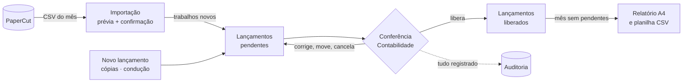
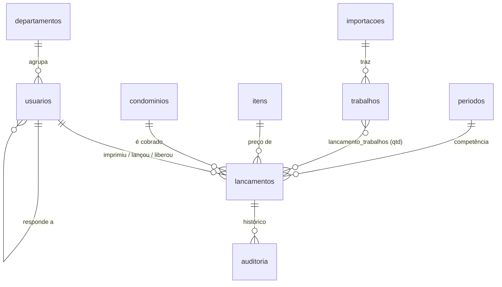

# Arquitetura

O COPP é um monólito pequeno de propósito: um processo Node, um arquivo SQLite e páginas renderizadas no servidor. Esta página explica o fluxo dos dados, o modelo e as decisões que não são óbvias olhando o código.

## Fluxo do mês



1. A Contabilidade exporta do PaperCut o registro de trabalhos de impressão e envia o CSV. O sistema mostra uma **prévia** (quantos trabalhos, quais condomínios, quanto vai custar, o que é novo) e só grava depois da confirmação.
2. Cada trabalho é dividido em páginas P&B, coloridas e frente e verso e agrupado em lançamentos por condomínio × item × descrição × quem imprimiu, dentro da competência.
3. Quem precisa lança à mão o que não passou pelo PaperCut. A condução é só da Expedição.
4. A Contabilidade confere: corrige descrição e quantidade na própria lista, move trabalhos cobrados do condomínio errado, cancela com motivo e libera.
5. Quando a competência não tem mais pendentes, o relatório por condomínio fica disponível para todos os perfis que o veem.

## Modelo de dados



| Tabela | Papel |
|---|---|
| `trabalhos` | Cada linha útil do CSV do PaperCut, com uma chave única (ver abaixo). Nunca é editada. |
| `lancamentos` | O que é cobrado do condomínio. Guarda o preço do momento, a situação (`pendente`, `liberado`, `cancelado`) e quem liberou. |
| `lancamento_trabalhos` | Liga lançamentos aos trabalhos que os formam, com a quantidade de cada um. É o que permite desfazer uma importação ou mover parte de um lançamento sem perder a rastreabilidade. |
| `periodos` | As datas de cada competência, gravadas quando ela nasce. Mudar a regra de fechamento não mexe em meses já entregues. |
| `departamentos` | O alcance de cada pessoa (`comum`, `gerencia`, `contabilidade`, `diretoria`) e se o departamento lança condução. |
| `auditoria` | Quem fez o quê, quando, e o antes e depois. |

As migrações ficam em `src/db.js` e são aditivas: cada coluna nova é criada se ainda não existir, então qualquer versão sobe sobre um banco de uma versão anterior.

## Decisões que valem explicar

### Chave do trabalho sem identificador

O export do PaperCut não tem ID de trabalho. A chave é um hash de `data e hora | usuário | impressora | documento | páginas`, mais a **ordem de aparição** dessa combinação no arquivo. Sem a ordem, duas reimpressões idênticas no mesmo segundo virariam uma só; com ela, continuam sendo duas, e a chave é a mesma toda vez que o mesmo arquivo é lido. Por isso importar de novo, ou importar arquivos parciais que se sobrepõem, não duplica nada.

### Importações parciais somam no pendente

Se um arquivo traz páginas de um lançamento que já existe e ainda está pendente (mesmo condomínio, item, descrição, quem imprimiu e alerta), as páginas somam nele em vez de criar outro. Liberados nunca recebem páginas novas.

### Desfazer respeita a correção manual

Ao desfazer uma importação ou mover trabalhos, a quantidade que sobra num lançamento é a soma das páginas que continuam ligadas a ele, a menos que alguém tenha corrigido a quantidade à mão. Nesse caso, a correção é mantida e só as páginas que saem são descontadas (`quantidadeRestante` em `src/papercut.js`).

### Competência com regra de fechamento mutável

O fechamento pode ser o mês do calendário ou um ciclo (de 16 a 15, por exemplo). Cada competência grava suas datas quando nasce. Ao mudar a regra, só os períodos sem nenhum lançamento liberado são refeitos; os meses já entregues à Contabilidade ficam como estão. Na transição, o primeiro período da regra nova pode sair mais curto ou mais longo, encaixado entre os vizinhos para nunca haver sobreposição.

### Permissões

```
Contabilidade, administrador   conferem, corrigem, movem, cancelam, liberam, reabrem
Diretoria                      veem tudo, não liberam
Gerência, supervisores         veem o que imprimiram e os condomínios que gerenciam
Todos                          lançam cópias manuais; corrigem o próprio enquanto pendente
Departamento com condução      lançam condução (a Expedição)
```

As regras ficam em poucas funções no topo de `src/routes/lancamentos.js` (`podeVer`, `podeMexer`, `podeLiberar`) e são conferidas em toda rota, não só na tela. `test/regras.test.js` tenta cada ação proibida com o perfil errado.

### Sem build e sem framework no navegador

As telas são EJS renderizado no servidor. O único script do navegador (`public/app.js`) só melhora o que já funciona sem ele: máscara de valores em reais, lista de descrições padrão, ordenação de colunas, contagem e confirmação da liberação em lote. A CSP proíbe script e estilo inline, e o sistema funciona com ela.

### Relatório A4 em HTML e CSS

As folhas do relatório são HTML com medidas em milímetros (`@page`, margem esquerda de 25 mm para a furação da pasta de prestação de contas). A paginação é calculada no servidor, estimando a altura de cada linha pela descrição, para que tela, PDF e impressão tenham o mesmo enquadramento.

## Operação

- **Backup**: `scripts/backup.js` faz `VACUUM INTO` (cópia consistente com o sistema no ar) e guarda os 30 mais recentes.
- **Saúde**: `GET /saude` responde `{"ok":true}` quando o banco responde; serve para monitor externo.
- **Publicação**: `deploy/publicar.sh` faz backup, instala a versão nova numa pasta ao lado, roda os testes, troca as pastas, reinicia e confere `/saude`; se falhar, volta sozinho.
- **Serviço**: `deploy/copp.service` roda como usuário sem login, com `ProtectSystem=strict` e escrita só na pasta de dados.
